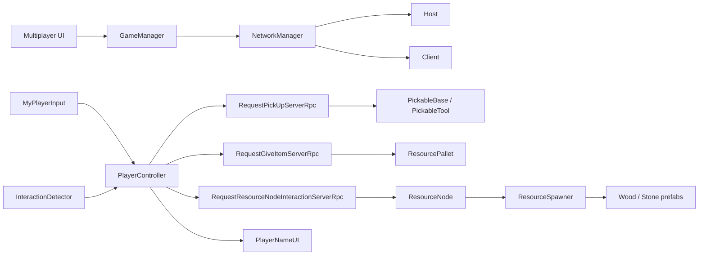
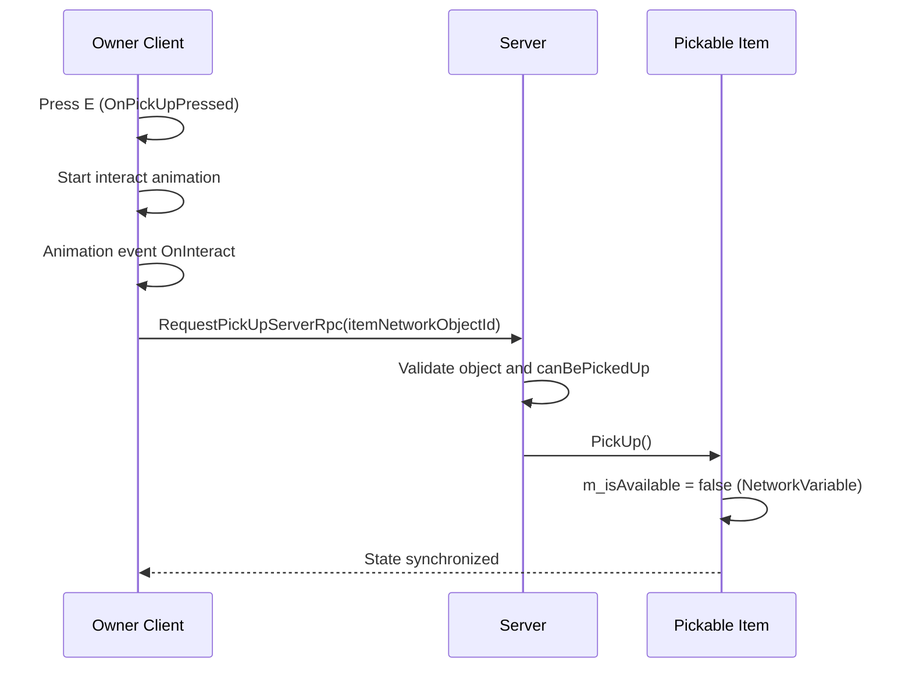
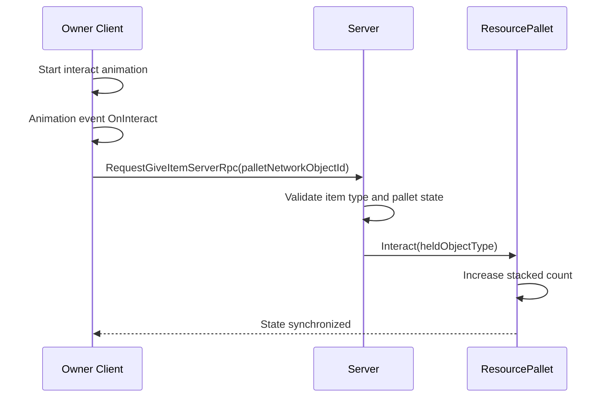
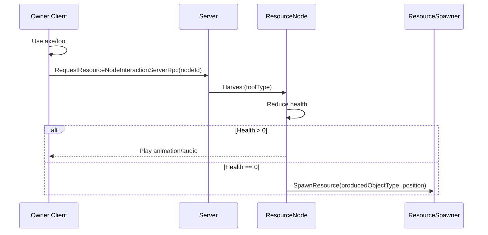

# Multiplayer Development Guide (Students)

This document explains how multiplayer is implemented in this Unity project using Netcode for GameObjects. The later steps add more gameplay depth: spawning players, interacting with objects, collecting resources, depositing them on pallets, showing player names, and checking a win condition.

Reference source repository:
- SunnyValleyStudio multiplayer tutorial repo: [multiplayer-basics-unity6-coop-harvest-game](https://github.com/SunnyValleyStudio/multiplayer-basics-unity6-coop-harvest-game)

## 1. Multiplayer Stack Used

- Unity Netcode for GameObjects
- NetworkManager (Host/Client startup and shutdown)
- NetworkBehaviour for network-aware scripts
- NetworkVariable for synchronized state
- Rpc (Server RPCs) for client-to-server actions
- Unity UI Toolkit (UIDocument) for player UI

Official docs:
- Netcode manual: [Netcode for GameObjects Manual](https://docs.unity3d.com/Packages/com.unity.netcode.gameobjects@2.13/manual/index.html)
- NetworkBehaviour: [NetworkBehaviour](https://docs.unity3d.com/Packages/com.unity.netcode.gameobjects@2.13/manual/basics/networkbehavior.html)
- NetworkVariable: [NetworkVariable](https://docs.unity3d.com/Packages/com.unity.netcode.gameobjects@2.13/manual/basics/networkvariable.html)
- RPC: [RPC](https://docs.unity3d.com/Packages/com.unity.netcode.gameobjects@2.13/manual/advanced-topics/message-system/rpc.html)

## 2. High-Level Architecture

## 3. Core Multiplayer Features Implemented

### 3.1 Session Control

- File: [Assets/_Scripts/GameManager.cs](Assets/_Scripts/GameManager.cs)
- File: [Assets/_Scripts/Premade Sctips/MultiplayerUI.cs](Assets/_Scripts/Premade%20Sctips/MultiplayerUI.cs)

What happens:
- UI buttons emit events for Start Host, Start Client, and Disconnect.
- GameManager listens to those events.
- GameManager calls NetworkManager.StartHost(), StartClient(), or Shutdown().
- When a client connects, the player prefab is spawned.
- After scene load completion, players are created automatically.

Why this matters:
- One central script manages the multiplayer session.
- The startup flow is easy to understand and test.

### 3.2 Ownership-Driven Input

- File: [Assets/_Scripts/MyPlayerInput.cs](Assets/_Scripts/MyPlayerInput.cs)

What happens:
- Only the owning player processes input (`IsOwner` check).
- Movement input is read and smoothed.
- Pressing E triggers `OnPickUpPressed`.
- Left click triggers `OnInteractPressed`.

Why this matters:
- Prevents remote clients from controlling other players.
- Reduces invalid actions and desync.

### 3.3 Player Interaction and Server Authority

- File: [Assets/_Scripts/PlayerController.cs](Assets/_Scripts/PlayerController.cs)

What happens:
- On spawn, the interaction detector is initialized with the owner status.
- The local player starts the interaction animation when the input is valid.
- Animation events call the interaction handler.
- The client sends three server RPCs:
  - RequestPickUpServerRpc for picking up an interactable item.
  - RequestGiveItemServerRpc for placing an item on a pallet.
  - RequestResourceNodeInteractionServerRpc for harvesting a resource node.
- The server validates and executes the action.

Why this matters:
- The client requests the action, but the server decides whether it is valid.
- This is the standard authoritative multiplayer pattern.

### 3.4 Finding the Interactable Target

- File: [Assets/_Scripts/InteractionDetector.cs](Assets/_Scripts/InteractionDetector.cs)

What happens:
- Runs only for the owner.
- Uses OverlapSphere to find nearby colliders in the pickup layer.
- Filters by detection angle.
- Chooses the closest valid IInteractable.
- Updates the selection outline when the target changes.

Why this matters:
- Gives deterministic local targeting behavior.
- Keeps candidate detection separate from execution logic.

### 3.5 Pickable Item Network State

- File: [Assets/_Scripts/PickableBase.cs](Assets/_Scripts/PickableBase.cs)
- File: [Assets/_Scripts/PickableTool.cs](Assets/_Scripts/PickableTool.cs)

What happens:
- Each pickable object has `NetworkVariable<bool> m_isAvailable`.
- Read permission: everyone.
- Write permission: server.
- When availability changes, `ApplyAvailabilityState` is called.
- `PickableTool` uses ComponentController to enable/disable object components.

Why this matters:
- One server-owned boolean controls visibility and availability across the network.
- All clients observe the same state.

### 3.6 Resource Node Harvesting

- File: [Assets/_Scripts/ResourceNode.cs](Assets/_Scripts/ResourceNode.cs)

What happens:
- Each node has a `NetworkVariable<int> m_health`.
- The server initializes the health on spawn.
- On harvest, the server reduces health.
- If health reaches zero, the node disables itself and spawns resources.
- Resources are spawned through ResourceSpawner.

Why this matters:
- Resource harvesting is server-authoritative.
- The state of the node is visible to all clients.

### 3.7 Server-Spawned Resources

- File: [Assets/_Scripts/ResourceSpawner.cs](Assets/_Scripts/ResourceSpawner.cs)

What happens:
- Only the server spawns resources.
- The script chooses the correct prefab based on the item type.
- The spawned object is created as a NetworkObject.

Why this matters:
- Prevents clients from creating resources independently.
- Keeps the game state synchronized.

### 3.8 Pallets and Deposit Logic

- File: [Assets/_Scripts/ResourcePallet.cs](Assets/_Scripts/ResourcePallet.cs)

What happens:
- Each pallet has an accepted object type and a stack limit.
- The `Interact()` method validates the incoming object type.
- If accepted, the pallet increments its stacked count.
- Audio feedback is played for the interaction.
- When the pallet is full, an event is raised.

Why this matters:
- Pallets are not just interactable objects; they are server-managed gameplay state.
- They connect item delivery to the win condition.

### 3.9 Player Name UI

- File: [Assets/_Scripts/PlayerNameUI.cs](Assets/_Scripts/PlayerNameUI.cs)

What happens:
- Uses a UIDocument label to display the player name.
- Stores the name in a `NetworkVariable<FixedString32Bytes>`.
- The server sets the name in the form `Player <OwnerClientId>`.
- The label updates when the value changes.

Why this matters:
- Makes the multiplayer session easier to understand during testing.
- Helps players identify which character belongs to which client.

## 4. End-to-End Pickup Flow (E Key)

## 5. End-to-End Deposit Flow

## 6. End-to-End Harvest Flow

## 7. Win Condition

- The GameManager counts the total stacked resources across all pallets.
- When the threshold is reached, it reloads the current scene.
- This is handled through `CheckWinCondition()`.

Why this matters:
- The game loop has a clear multiplayer end condition.
- It is easy to test by running multiple clients and observing the shared state.

## 8. Data Synchronization Table

| Data | Type | Owner | Who Reads | Where |
|---|---|---|---|---|
| Item availability | NetworkVariable<bool> | Server | Everyone | PickableBase |
| Held network object id | NetworkVariable<ulong> | Server flow | Everyone (net sync) | PlayerController |
| Held object type | NetworkVariable<ObjectType> | Server flow | Everyone (net sync) | PlayerController |
| Resource node health | NetworkVariable<int> | Server | Everyone | ResourceNode |
| Pallet stacked resources | NetworkVariable<int> | Server | Everyone | ResourcePallet |
| Player name | NetworkVariable<FixedString32Bytes> | Server | Everyone | PlayerNameUI |
| Movement input | Local value | Owner | Owner only | MyPlayerInput |

## 9. Current Scope

This project currently focuses on:
- multiplayer session setup (Host/Client)
- owner-based input and movement
- pickup and item transfer with server authority
- resource node harvesting and resource spawning
- pallet-based deposit logic and win condition
- player-name UI synchronization

## 10. Student Checklist

- Confirm Host and Client both connect using the UI buttons.
- Confirm only the local player responds to local input.
- Confirm E pickup works only when the target is in range and within the detection angle.
- Confirm pickup, give-item, and harvest actions are executed through Server RPCs.
- Confirm resources are spawned by the server.
- Confirm pallets update their stacked state correctly.
- Confirm the win condition triggers when the threshold is reached.
- Confirm each player’s name appears in the UI.

## 11. Typical Debug Questions

- “Why does only one player move?” -> Check `IsOwner` logic in input and movement.
- “Why does pickup not happen?” -> Check detector target, RPC call, and server validation.
- “Why do clients disagree on item state?” -> Check NetworkVariable permissions and callbacks.
- “Why does deposit not work?” -> Check the pallet validation logic, held object type, and server RPC.
- “Why are resources not spawning?” -> Check ResourceSpawner, ResourceNode, and NetworkObject spawn state.
- “Why are callbacks firing multiple times?” -> Check subscribe/unsubscribe symmetry.
