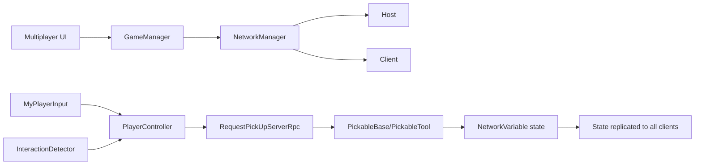
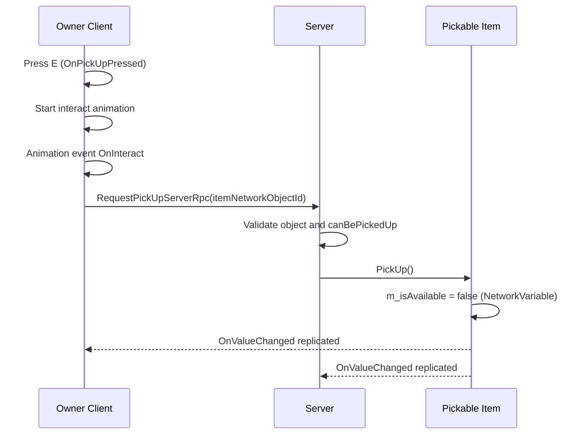

# Multiplayer Development Guide (Students)

This document explains how multiplayer is implemented in this Unity project using Netcode for GameObjects.

Reference source repository:
- SunnyValleyStudio multiplayer tutorial repo: [multiplayer-basics-unity6-coop-harvest-game](https://github.com/SunnyValleyStudio/multiplayer-basics-unity6-coop-harvest-game)

## 1. Multiplayer Stack Used

- Unity Netcode for GameObjects
- NetworkManager (Host/Client startup and shutdown)
- NetworkBehaviour for network-aware scripts
- NetworkVariable for synchronized state
- Rpc (Server RPCs) for client-to-server actions

Official docs:
- Netcode manual: [Netcode for GameObjects Manual](https://docs.unity3d.com/Packages/com.unity.netcode.gameobjects@2.13/manual/index.html)
- NetworkBehaviour: [NetworkBehaviour](https://docs.unity3d.com/Packages/com.unity.netcode.gameobjects@2.13/manual/basics/networkbehavior.html)
- NetworkVariable: [NetworkVariable](https://docs.unity3d.com/Packages/com.unity.netcode.gameobjects@2.13/manual/basics/networkvariable.html)
- RPC: [RPC](https://docs.unity3d.com/Packages/com.unity.netcode.gameobjects@2.13/manual/advanced-topics/message-system/rpc.html)

## 2. High-Level Architecture

## 3. Core Multiplayer Scripts

### 3.1 Session Control

- File: [Assets/_Scripts/GameManager.cs](Assets/_Scripts/GameManager.cs)
- File: [Assets/_Scripts/Premade Sctips/MultiplayerUI.cs](Assets/_Scripts/Premade%20Sctips/MultiplayerUI.cs)

What happens:
- UI buttons emit events (Start Host, Start Client, Disconnect).
- GameManager listens to those events.
- GameManager calls NetworkManager.StartHost(), StartClient(), or Shutdown().

Why this matters:
- Keeps UI and networking responsibilities separate.
- Makes startup flow easy to test.

### 3.2 Ownership-Driven Input

- File: [Assets/_Scripts/MyPlayerInput.cs](Assets/_Scripts/MyPlayerInput.cs)

What happens:
- Only the owning player processes input (`IsOwner` check).
- Movement input is read and smoothed.
- Pressing E triggers `OnPickUpPressed`.
- Left click triggers `OnInteractPressed`.

Why this matters:
- Prevents remote clients from controlling other players.
- Reduces desync and invalid actions.

### 3.3 Player Interaction and Server Authority

- File: [Assets/_Scripts/PlayerController.cs](Assets/_Scripts/PlayerController.cs)

What happens:
- On spawn, interaction detector is initialized with ownership.
- Local player starts interact animation when pickup input is valid.
- Animation event calls interaction action.
- Client sends `RequestPickUpServerRpc(ulong networkObjectId)`.
- Server validates target and applies pickup.

Why this matters:
- Client requests action.
- Server validates and executes action.
- This is the standard authoritative multiplayer pattern.

### 3.4 Finding the Interactable Target

- File: [Assets/_Scripts/InteractionDetector.cs](Assets/_Scripts/InteractionDetector.cs)

What happens:
- Runs only for owner.
- Uses OverlapSphere to find nearby colliders in pickup layer.
- Filters by detection angle.
- Chooses the closest valid IInteractable.
- Updates selection outline when target changes.

Why this matters:
- Gives deterministic local targeting behavior.
- Keeps interaction candidate logic separate from pickup execution logic.

### 3.5 Pickable Item Network State

- File: [Assets/_Scripts/PickableBase.cs](Assets/_Scripts/PickableBase.cs)
- File: [Assets/_Scripts/PickableTool.cs](Assets/_Scripts/PickableTool.cs)

What happens:
- Each pickable has `NetworkVariable<bool> m_isAvailable`.
- Read permission: everyone.
- Write permission: server.
- When availability changes, `ApplyAvailabilityState` is called.
- `PickableTool` uses ComponentController to enable/disable object components.

Why this matters:
- One server-owned boolean drives visibility/availability across the network.
- All clients observe the same state.

### 3.6 Owner Camera Behavior

- File: [Assets/_Scripts/CameraFollow.cs](Assets/_Scripts/CameraFollow.cs)

What happens:
- On spawn, only owner camera starts following local player.
- On despawn, camera is reset.

Why this matters:
- Prevents one client camera from attaching to another player's character.

## 4. End-to-End Pickup Flow (E Key)

## 5. Important Multiplayer Concepts in This Project

### 5.1 Owner-Only Logic

Used in:
- input handling
- movement
- interaction detector
- camera follow

Purpose:
- only the local player controls local character features.

### 5.2 Server-Only State Changes

Used in:
- pickable availability
- pickup action final execution

Purpose:
- anti-cheat and consistency.

### 5.3 Event Subscription Hygiene

Used in:
- OnNetworkSpawn / OnNetworkDespawn
- OnEnable / OnDisable

Purpose:
- avoid duplicate callbacks and memory leaks.

## 6. Data Synchronization Table

| Data | Type | Owner | Who Reads | Where |
|---|---|---|---|---|
| Item availability | NetworkVariable<bool> | Server | Everyone | PickableBase |
| Held network object id | NetworkVariable<ulong> | Server flow | Everyone (net sync) | PlayerController |
| Held object type | NetworkVariable<ObjectType> | Server flow | Everyone (net sync) | PlayerController |
| Movement input | Local value | Owner | Owner only | MyPlayerInput |

## 7. Student Checklist

- Confirm Host and Client both connect using UI buttons.
- Confirm only local player responds to local input.
- Confirm E pickup only works when target is in radius and angle.
- Confirm pickup action is executed through Server RPC.
- Confirm picked item becomes unavailable for all clients.
- Confirm selection outline updates when target changes.

## 8. Typical Debug Questions

- "Why does only one player move?" -> Check `IsOwner` logic in input and movement.
- "Why does pickup not happen?" -> Check detector target, RPC call, and server validation.
- "Why do clients disagree on item state?" -> Check NetworkVariable permissions and callbacks.
- "Why are callbacks firing multiple times?" -> Check subscribe/unsubscribe symmetry.

## 9. Current Scope Notes

This project currently focuses on:
- multiplayer session setup
- owner-based control
- synchronized pickup availability
- basic held-item state variables

If you continue to later tutorial steps (for example resource harvesting), extend this document with additional RPC and state sync flows.
