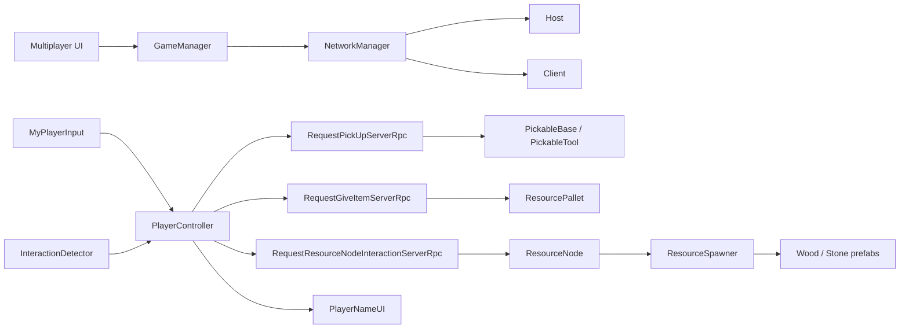
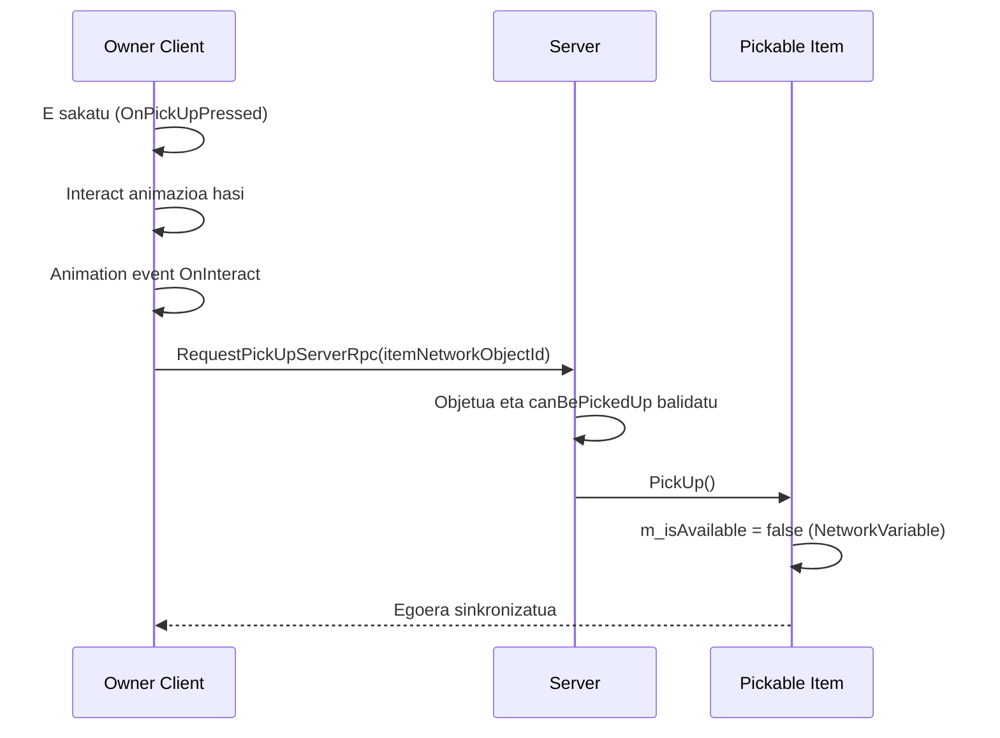
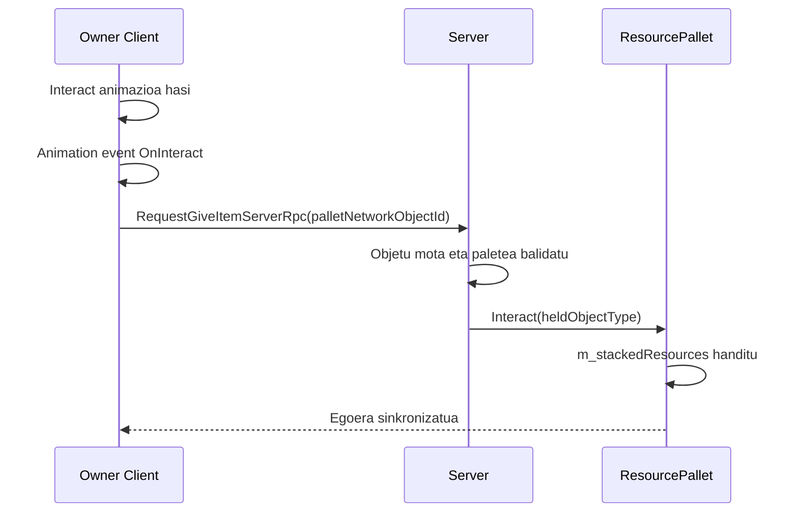
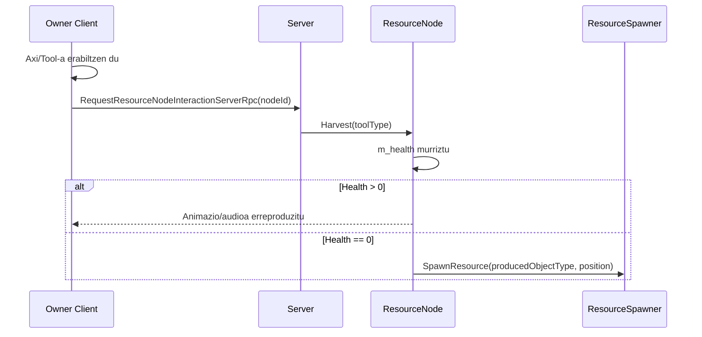

# Multiplayer Garapen Gida (Ikasleak)

Dokumentu honek proiektu honetako multiplayer sistema azaltzen du, Unity Netcode for GameObjects erabiliz. Azken urratsetan ezaugarri gehiago gehitu dira: jokalariak sortzea, interakzioa, baliabideak biltzea, paleteetan uztea, jokalariaren izena erakustea eta irabazteko baldintza.

Erreferentzia iturburu errepositorioa:
- SunnyValleyStudio multiplayer tutorial repo: [multiplayer-basics-unity6-coop-harvest-game](https://github.com/SunnyValleyStudio/multiplayer-basics-unity6-coop-harvest-game)

## 1. Erabilitako Multiplayer Stack-a

- Unity Netcode for GameObjects
- NetworkManager (Host/Client hasiera eta itxiera)
- NetworkBehaviour (sareko scriptentzat)
- NetworkVariable (egoera sinkronizatzeko)
- Rpc (Server RPC) bezeroak zerbitzariari ekintzak eskatzeko
- Unity UI Toolkit (UIDocument) jokalariaren UIa erakusteko

Dokumentazio ofiziala:
- Netcode manuala: [Netcode for GameObjects Manual](https://docs.unity3d.com/Packages/com.unity.netcode.gameobjects@2.13/manual/index.html)
- NetworkBehaviour: [NetworkBehaviour](https://docs.unity3d.com/Packages/com.unity.netcode.gameobjects@2.13/manual/basics/networkbehavior.html)
- NetworkVariable: [NetworkVariable](https://docs.unity3d.com/Packages/com.unity.netcode.gameobjects@2.13/manual/basics/networkvariable.html)
- RPC: [RPC](https://docs.unity3d.com/Packages/com.unity.netcode.gameobjects@2.13/manual/advanced-topics/message-system/rpc.html)

## 2. Maila Altuko Arkitektura

## 3. Inplementatutako Multiplayer Funtzionalitate Nagusiak

### 3.1 Saio Kontrola

- File: [Assets/_Scripts/GameManager.cs](Assets/_Scripts/GameManager.cs)
- File: [Assets/_Scripts/Premade Sctips/MultiplayerUI.cs](Assets/_Scripts/Premade%20Sctips/MultiplayerUI.cs)

Zer gertatzen da:
- UI botoiek Start Host, Start Client eta Disconnect ekitaldiak bidaltzen dituzte.
- GameManager-ek ekitaldi hauek entzuten ditu.
- GameManager-ek NetworkManager.StartHost(), StartClient() edo Shutdown() deitzen du.
- Bezero berriak konektatzen direnean, jokalaria spawneatzen da.
- Scene kargaren ondoren jokalariak automatiko sortzen dira.

Zergatik da garrantzitsua:
- Sareko saioa kudeatzeko zentro bakarra daukagu.
- Hasierako fluxua sinplea eta errepikagarria da.

### 3.2 Ownership-ean Oinarritutako Input-a

- File: [Assets/_Scripts/MyPlayerInput.cs](Assets/_Scripts/MyPlayerInput.cs)

Zer gertatzen da:
- Jabea den jokalariak bakarrik prozesatzen du input-a (IsOwner check).
- Mugimendu input-a irakurri eta leundu egiten da.
- E sakatzean OnPickUpPressed jaurtitzen da.
- Ezker klik-ean OnInteractPressed jaurtitzen da.

Zergatik da garrantzitsua:
- Urruneko client-ek beste jokalariak kontrolatzea saihesten du.
- Input ez-esanguratsuak eta desinkronizazioak murrizten ditu.

### 3.3 Jokalariaren Interakzioa eta Zerbitzariaren Autoritatea

- File: [Assets/_Scripts/PlayerController.cs](Assets/_Scripts/PlayerController.cs)

Zer gertatzen da:
- Spawn-ean, InteractionDetector hasieratzen da owned statusarekin.
- Local jokalariak interact animazioa abiarazten du input baliagarria bada.
- Animazio event-ak HandleInteractAction deitzen du.
- Bezeroak hiru server RPC mota bidaltzen ditu:
  - RequestPickUpServerRpc: pickable objektu bat hartzeko.
  - RequestGiveItemServerRpc: objektua palete batera utitzeko.
  - RequestResourceNodeInteractionServerRpc: baliabide nodoa harrasteko.
- Zerbitzariak ekintza balidatzen eta exekutatzen du.

Zergatik da garrantzitsua:
- Bezeroak ekintza eskatzen du, baina zerbitzariak agintzen du.
- Hau da autoritaterako multiplayer patroia.

### 3.4 Interactable Helburua Aurkitzea

- File: [Assets/_Scripts/InteractionDetector.cs](Assets/_Scripts/InteractionDetector.cs)

Zer gertatzen da:
- Jabearentzat bakarrik exekutatzen da.
- OverlapSphere erabiliz inguruko collider-ak bilatzen ditu pickup layer-en.
- Detekzio angeluaren arabera iragazten du.
- Baliozko IInteractable hurbilena aukeratzen du.
- Helburua aldatzean selection outline eguneratzen du.

Zergatik da garrantzitsua:
- Tokiko targeting portaera determinista ematen du.
- Interakzio hautagaiaren logika eta ekintza exekuzio logika bereizten ditu.

### 3.5 Pickable Objektuen Sareko Egoera

- File: [Assets/_Scripts/PickableBase.cs](Assets/_Scripts/PickableBase.cs)
- File: [Assets/_Scripts/PickableTool.cs](Assets/_Scripts/PickableTool.cs)

Zer gertatzen da:
- Pickable bakoitzak NetworkVariable<bool> m_isAvailable dauka.
- Read permission: everyone.
- Write permission: server.
- Disponibilitatea aldatzean ApplyAvailabilityState deitzen da.
- PickableTool-ek ComponentController erabiltzen du osagaiak aktibatu/desaktibatzeko.

Zergatik da garrantzitsua:
- Zerbitzariak kontrolatutako boolean bakar batek ikusgarritasuna/disponibilitatea gidatzen du sare osoan.
- Client guztiek egoera bera ikusten dute.

### 3.6 Baliabide Nodoen Bilketa (Harvesting)

- File: [Assets/_Scripts/ResourceNode.cs](Assets/_Scripts/ResourceNode.cs)

Zer gertatzen da:
- Nodo bakoitzak NetworkVariable<int> m_health dauka.
- Zerbitzariak hasieratzen du osasuna.
- Bilketan, zerbitzariak osasuna murrizten du.
- Osasuna 0 bada, nodoa desaktibatzen da eta baliabideak sortzen dira.
- Baliabideak ResourceSpawner bidez spawneatzen dira.

Zergatik da garrantzitsua:
- Harkaitz/egur bezalako baliabideak sarean sinkronizatuta sortzen dira.
- Bilketaren logika zerbitzariak kontrolatzen du.

### 3.7 Baliabideen Sortzea Zerbitzaritik

- File: [Assets/_Scripts/ResourceSpawner.cs](Assets/_Scripts/ResourceSpawner.cs)

Zer gertatzen da:
- Server-ak bakarrik sortzen ditu baliabideak.
- Wood edo Stone motaren arabera dagokion prefab-a instantiatzen du.
- Sortutako objektua NetworkObject gisa spawneatzen du.

Zergatik da garrantzitsua:
- Baliabideak ez dira bezeroek era libre sortzen.
- Horrela ez da desinkronizaziorik eta anticheat-a murrizten da.

### 3.8 Paleteak eta Eskuarki Objektua Jartzea

- File: [Assets/_Scripts/ResourcePallet.cs](Assets/_Scripts/ResourcePallet.cs)

Zer gertatzen da:
- Palete bakoitzak m_acceptedObjectType dauka eta zenbat elementu pilatu daitezkeen kontrolatzen du.
- Interact() metodoak bezeroak bidalitako objetu mota balidatzen du.
- Paleteak elementu bat onartzen du eta m_stackedResources handitzen du.
- Mugimenduaren ondoren audioa erreproduzitzen da.
- Paletea beteta dagoenean, OnPalletFilled event-a jaurtitzen du.

Zergatik da garrantzitsua:
- Paleteak ez dira soilik “interactuable” objektuak; zerbitzariak kontrolatutako egoera eta irabazteko baldintza bat dira.

### 3.9 Jokalariaren Izena UI-an

- File: [Assets/_Scripts/PlayerNameUI.cs](Assets/_Scripts/PlayerNameUI.cs)

Zer gertatzen da:
- UIDocument-eko Label bat erabiltzen du jokalariaren izenarekin.
- NetworkVariable<FixedString32Bytes> erabiltzen du izena sarean sinkronizatzeko.
- Zerbitzariak izena ezartzen du formatu honetan: Player <OwnerClientId>.
- Balio aldatu ahala, etiketa eguneratzen da.

Zergatik da garrantzitsua:
- Jokalariak nor den ikus dezaten aukera ematen du.
- Erabiltzailearen esperientzia hobetzen du multiplayer test-ean.

## 4. Fluxu Osoa: Item-a Hartzea

## 5. Fluxu Osoa: Elementua Paletean Utzita

## 6. Fluxu Osoa: Baliabidea Bilketa

## 7. Irabazteko Baldintza

- GameManager-ek palete guztien pilatutako baliabide kopurua kontatzen du.
- Ezarritako irizpidea betetzen denean, uneko scene-a berriro kargatzen du.
- Hori beheko metodoarekin egiten da:
  - CheckWinCondition()

Zergatik da garrantzitsua:
- Jokoaren egoera berriro hasieratzen da eta partida amaitutzat hartu daiteke.
- Multijokalariaren fluxua eta UIa testatzeko erabilgarria da.

## 8. Datu Sinkronizazio Taula

| Datuak | Mota | Jabea | Nork irakurtzen du | Non |
|---|---|---|---|---|
| Item disponibilitatea | NetworkVariable<bool> | Server | Everyone | PickableBase |
| Held network object id | NetworkVariable<ulong> | Server flow | Everyone (net sync) | PlayerController |
| Held object type | NetworkVariable<ObjectType> | Server flow | Everyone (net sync) | PlayerController |
| Resource node health | NetworkVariable<int> | Server | Everyone | ResourceNode |
| Pallet stacked resources | NetworkVariable<int> | Server | Everyone | ResourcePallet |
| Player name | NetworkVariable<FixedString32Bytes> | Server | Everyone | PlayerNameUI |
| Movement input | Local value | Owner | Owner only | MyPlayerInput |

## 9. Proiektuaren Uneko Scope-a

Proiektu honek une honetan honakoak lantzen ditu:
- multiplayer saio hasiera (Host/Client)
- owner-based input eta mugimendua
- pickup eta item transferentzia zerbitzariaren autoritatearekin
- resource node harvesting eta resource spawn
- paleteetan item-ak pilatzea eta irabazteko baldintza
- jokalariaren izena UI-an sinkronizatzea

## 10. Ikasleen Egiaztapen Zerrenda

- Egiaztatu Host eta Client biak konektatzen direla UI botoiekin.
- Egiaztatu tokiko jokalariak bakarrik erantzuten diola tokiko input-ari.
- Egiaztatu E pickup-a radius eta angle barruan bakarrik funtzionatzen duela.
- Egiaztatu pickup, give-item eta harvest ekintzak Server RPC bidez exekutatzen direla.
- Egiaztatu item-ak eta baliabideak zerbitzariak sortzen dituela.
- Egiaztatu paleteek pilaketa eta irabazteko baldintza egokiak egiten dituztela.
- Egiaztatu jokalariaren izena denontzat agertzen dela.

## 11. Debug Galdera Ohikoak

- Zergatik mugitzen da jokalari bakarra? -> IsOwner logika begiratu input eta movement-en.
- Zergatik ez dabil pickup-a? -> Detector target-a, RPC deia eta server balidazioa begiratu.
- Zergatik ez datoz bat client-en item egoerak? -> NetworkVariable baimenak eta callback-ak begiratu.
- Zergatik ez dabil paleteetan uztea? -> Interact() balidazioa, held object type, eta server RPC begiratu.
- Zergatik ez sortzen dira baliabideak? -> ResourceSpawner, ResourceNode eta NetworkObject spawn egoera begiratu.
- Zergatik jaurtitzen dira callback-ak behin baino gehiagotan? -> subscribe/unsubscribe simetria begiratu.
