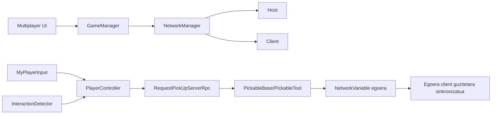
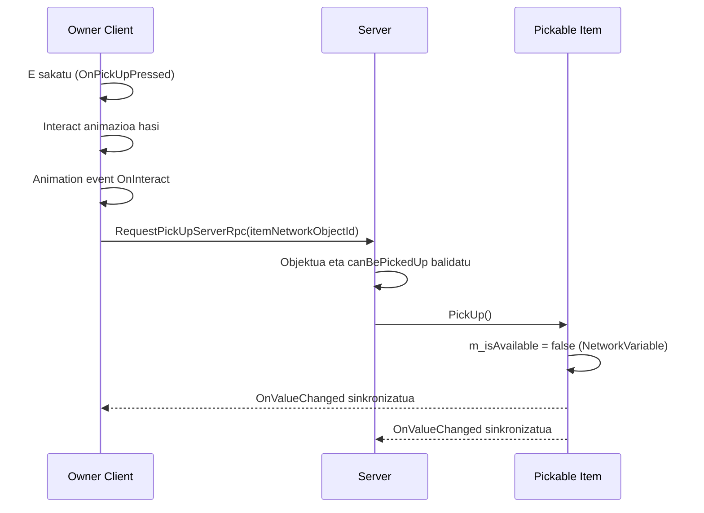

# Multiplayer Garapen Gida (Ikasleak)

Dokumentu honek azaltzen du nola dagoen inplementatuta multiplayer sistema proiektu honetan, Unity Netcode for GameObjects erabiliz.

## 1. Erabilitako Multiplayer Stack-a

- Unity Netcode for GameObjects
- NetworkManager (Host/Client hasiera eta itxiera)
- NetworkBehaviour (sareko scriptentzat)
- NetworkVariable (egoera sinkronizatzeko)
- Rpc (Server RPC) bezeroak zerbitzariari ekintzak eskatzeko

Dokumentazio ofiziala:
- Netcode manuala: https://docs.unity3d.com/Packages/com.unity.netcode.gameobjects@2.13/manual/index.html
- NetworkBehaviour: https://docs.unity3d.com/Packages/com.unity.netcode.gameobjects@2.13/manual/basics/networkbehavior.html
- NetworkVariable: https://docs.unity3d.com/Packages/com.unity.netcode.gameobjects@2.13/manual/basics/networkvariable.html
- RPC: https://docs.unity3d.com/Packages/com.unity.netcode.gameobjects@2.13/manual/advanced-topics/message-system/rpc.html

## 2. Maila Altuko Arkitektura

## 3. Multiplayer Script Nagusiak

### 3.1 Saio Kontrola

- File: Assets/_Scripts/GameManager.cs
- File: Assets/_Scripts/Premade Sctips/MultiplayerUI.cs

Zer gertatzen da:
- UI botoiek event-ak jaurtitzen dituzte (Start Host, Start Client, Disconnect).
- GameManager-ek event horiek entzuten ditu.
- GameManager-ek NetworkManager.StartHost(), StartClient() edo Shutdown() deitzen du.

Zergatik da garrantzitsua:
- UI eta sareko erantzukizunak banatzen ditu.
- Hasierako fluxua erraz probatzeko aukera ematen du.

### 3.2 Ownership-ean Oinarritutako Input-a

- File: Assets/_Scripts/MyPlayerInput.cs

Zer gertatzen da:
- Jabea den jokalariak bakarrik prozesatzen du input-a (IsOwner check).
- Mugimendu input-a irakurri eta leundu egiten da.
- E sakatzean OnPickUpPressed jaurtitzen da.
- Ezker klik-ean OnInteractPressed jaurtitzen da.

Zergatik da garrantzitsua:
- Urruneko client-ek beste jokalariak kontrolatzea saihesten du.
- Desinkronizazioak eta ekintza baliogabeak murrizten ditu.

### 3.3 Jokalariaren Interakzioa eta Zerbitzariaren Autoritatea

- File: Assets/_Scripts/PlayerController.cs

Zer gertatzen da:
- Spawn egitean, interaction detector-a ownershiparekin hasieratzen da.
- Pickup input-a baliozkoa bada, tokiko jokalariak interact animazioa hasten du.
- Animazio event-ak interaction ekintza deitzen du.
- Bezeroak RequestPickUpServerRpc(ulong networkObjectId) bidaltzen du.
- Zerbitzariak helburua balidatu eta pickup aplikatzen du.

Zergatik da garrantzitsua:
- Bezeroak ekintza eskatzen du.
- Zerbitzariak balidatu eta exekutatzen du.
- Hau da multiplayer autoritatiboaren patroi estandarra.

### 3.4 Interactable Helburua Aurkitzea

- File: Assets/_Scripts/InteractionDetector.cs

Zer gertatzen da:
- Jabearentzat bakarrik exekutatzen da.
- OverlapSphere erabiliz inguruko collider-ak bilatzen ditu pickup layer-en.
- Detekzio angeluaren arabera iragazten du.
- Baliozko IInteractable hurbilena aukeratzen du.
- Helburua aldatzean selection outline eguneratzen du.

Zergatik da garrantzitsua:
- Tokiko targeting portaera determinista ematen du.
- Interakzio hautagaiaren logika eta pickup exekuzio logika bereizten ditu.

### 3.5 Pickable Objektuen Sareko Egoera

- File: Assets/_Scripts/PickableBase.cs
- File: Assets/_Scripts/PickableTool.cs

Zer gertatzen da:
- Pickable bakoitzak NetworkVariable<bool> m_isAvailable dauka.
- Read permission: everyone.
- Write permission: server.
- Disponibilitatea aldatzean ApplyAvailabilityState deitzen da.
- PickableTool-ek ComponentController erabiltzen du osagaiak aktibatu/desaktibatzeko.

Zergatik da garrantzitsua:
- Zerbitzariak kontrolatutako boolean bakar batek ikusgarritasuna/disponibilitatea gidatzen du sare osoan.
- Client guztiek egoera bera ikusten dute.

### 3.6 Jabe Camararen Portaera

- File: Assets/_Scripts/CameraFollow.cs

Zer gertatzen da:
- Spawn-ean, jabearen camarak bakarrik jarraitzen du tokiko jokalaria.
- Despawn-ean, camara reset egiten da.

Zergatik da garrantzitsua:
- Client baten camara beste jokalari bati lotzea saihesten du.

## 4. E Teklako Pickup Fluxu Osoa

## 5. Proiektuko Multiplayer Kontzeptu Garrantzitsuak

### 5.1 Owner-Only Logika

Erabilita hemen:
- input kudeaketa
- mugimendua
- interaction detector
- camera follow

Helburua:
- tokiko jokalariak bakarrik kontrola ditzala bere tokiko ezaugarriak.

### 5.2 Server-Only Egoera Aldaketak

Erabilita hemen:
- pickable disponibilitatea
- pickup ekintzaren azken exekuzioa

Helburua:
- anti-cheat eta koherentzia.

### 5.3 Event Harpidetzen Higienea

Erabilita hemen:
- OnNetworkSpawn / OnNetworkDespawn
- OnEnable / OnDisable

Helburua:
- callback bikoiztuak eta memory leak-ak saihestea.

## 6. Datu Sinkronizazio Taula

| Datuak | Mota | Jabea | Nork irakurtzen du | Non |
|---|---|---|---|---|
| Item disponibilitatea | NetworkVariable<bool> | Server | Everyone | PickableBase |
| Held network object id | NetworkVariable<ulong> | Server flow | Everyone (net sync) | PlayerController |
| Held object type | NetworkVariable<ObjectType> | Server flow | Everyone (net sync) | PlayerController |
| Movement input | Local value | Owner | Owner only | MyPlayerInput |

## 7. Ikasleen Egiaztapen Zerrenda

- Egiaztatu Host eta Client biak konektatzen direla UI botoiekin.
- Egiaztatu tokiko jokalariak bakarrik erantzuten diola tokiko input-ari.
- Egiaztatu E pickup-a radius eta angle barruan bakarrik funtzionatzen duela.
- Egiaztatu pickup ekintza Server RPC bidez exekutatzen dela.
- Egiaztatu jasotako item-a client guztientzat ez-eskuragarri bihurtzen dela.
- Egiaztatu selection outline eguneratzen dela helburua aldatzean.

## 8. Debug Galdera Ohikoak

- Zergatik mugitzen da jokalari bakarra? -> IsOwner logika begiratu input eta movement-en.
- Zergatik ez dabil pickup-a? -> Detector target-a, RPC deia eta server balidazioa begiratu.
- Zergatik ez datoz bat client-en item egoerak? -> NetworkVariable baimenak eta callback-ak begiratu.
- Zergatik jaurtitzen dira callback-ak behin baino gehiagotan? -> subscribe/unsubscribe simetria begiratu.

## 9. Uneko Scope Oharra

Proiektu honek une honetan honakoak lantzen ditu:
- multiplayer saio hasiera
- owner-en araberako kontrola
- pickup disponibilitate sinkronizatua
- held-item egoera aldagai oinarrizkoak

Geroagoko tutorial urratsetara joanez gero (adibidez resource harvesting), hedatu dokumentu hau RPC eta egoera sinkronizazio fluxu gehiagorekin.
